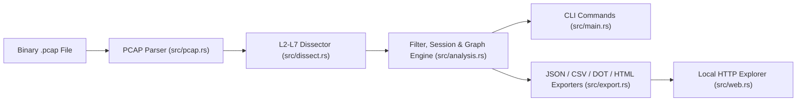

# NetScope

Pure-Rust PCAP network traffic analyzer, multi-layer protocol dissector, session tracker, and interactive communication graph visualizer.

## Purpose & Problem Statement

Inspecting `.pcap` captures in headless or container environments often requires heavy C dependencies (`libpcap`) or GUI tools unavailable on servers. NetScope implements a pure-Rust PCAP parser and L2–L7 dissector with zero native C dependencies, offering CLI filtering, session state reconstruction, Graphviz DOT communication maps, standalone HTML visualizations, and a built-in HTTP explorer (`netscope serve`).

## Features

- **Pure-Rust PCAP Parsing**: Supports little-endian and big-endian microsecond (`0xa1b2c3d4`) and nanosecond (`0xa1b23c4d`) `.pcap` captures.
- **L2–L7 Protocol Dissection**: Decodes Ethernet II, 802.1Q VLAN tags, ARP requests/replies, IPv4, IPv6, ICMP/ICMPv6, TCP (flags and payload sizes), UDP, and DNS queries/responses.
- **Session & Flow Reconstruction**: Aggregates 5-tuple TCP/UDP conversations with packet/byte counters and TCP handshake/termination state (`SYN_SENT`, `ESTABLISHED`, `CLOSED`, `RESET`).
- **Filtering & Packet Inspection**: Filter frames by `--proto`, `--ip`, or `--port` and inspect individual packets in full JSON (`netscope inspect`).
- **Communication Mapping & Visualizations**: Export Graphviz DOT graphs, CSV tables, JSON bundles, standalone HTML Canvas graph reports, or serve them over HTTP (`netscope serve`).

## Tech Stack

- **Language**: Rust (2021 edition)
- **Crates**: `clap` (CLI), `serde` & `serde_json` (serialization)
- **HTTP Explorer**: Built-in `std::net::TcpListener` (no external web framework required)

## System Requirements

- Rust toolchain (`rustc` / `cargo` 1.75+)

## Installation

```bash
git clone https://github.com/fully-ai/netscope.git
cd netscope
cargo build --release
```

## Configuration & CLI Commands

| Command | Flags | Description |
| --- | --- | --- |
| `analyze <file>` | — | Print packet/byte totals, protocol counts, top talkers, and session counts |
| `packets <file>` | `--proto`, `--ip`, `--port` | List filtered dissected packets |
| `sessions <file>` | — | Show reconstructed 5-tuple TCP/UDP flows and TCP states |
| `dns <file>` | — | Extract DNS query/response records |
| `arp <file>` | — | Extract ARP requests and replies |
| `inspect <file>` | `--index <N>` | Output full JSON dissection for packet `#N` |
| `export <file>` | `--format <json\|csv\|dot\|html>`, `--output <path>` | Export report and graph |
| `serve <file>` | `--addr <host:port>` | Serve interactive HTML explorer + JSON API |

## Running & Usage Examples

```bash
./target/release/netscope analyze capture.pcap
./target/release/netscope packets capture.pcap --proto tcp --port 443
./target/release/netscope inspect capture.pcap --index 2
./target/release/netscope export capture.pcap --format dot --output topology.dot
./target/release/netscope serve capture.pcap --addr 127.0.0.1:8088
```

## API Documentation (`netscope serve`)

| Method & Path | Description |
| --- | --- |
| `GET /` | Interactive HTML Canvas communication graph and packet table |
| `GET /api/report` | Full `AnalysisReport` JSON (protocols, top talkers, sessions, edges) |
| `GET /api/packets` | Array of dissected packet records in JSON |

## Architecture



## File Structure

```
netscope/
├── src/
│   ├── lib.rs            # Crate exports
│   ├── pcap.rs           # Pure-Rust libpcap reader
│   ├── dissect.rs        # Ethernet, 802.1Q, ARP, IPv4/v6, TCP/UDP, ICMP, DNS
│   ├── analysis.rs       # Filtering, talkers, sessions, communication edges
│   ├── export.rs         # JSON, CSV, Graphviz DOT, HTML Canvas report
│   ├── web.rs            # Local HTTP explorer (`netscope serve`)
│   └── main.rs           # Clap CLI entrypoint
├── tests/integration.rs  # Binary PCAP, VLAN, IPv6, ICMPv6, DNS, ARP, TCP tests
├── docs/architecture.md
└── Dockerfile
```

## Testing

```bash
cargo fmt --check
cargo clippy --all-targets -- -D warnings
cargo test --verbose
```

## Docker Deployment

```bash
docker build -t netscope .
docker run --rm -v "$PWD/capture.pcap:/data/capture.pcap:ro" netscope analyze /data/capture.pcap
```

## Security Notes

- Operates strictly offline on capture files; requires no `CAP_NET_RAW` or elevated privileges.

## Known Limitations

- Supports standard libpcap `.pcap` files (`LINKTYPE_ETHERNET=1`); `.pcapng` blocks and live NIC packet capture are not implemented.

## Contributing

See [CONTRIBUTING.md](CONTRIBUTING.md) and [CODE_OF_CONDUCT.md](CODE_OF_CONDUCT.md).

## License

Apache License 2.0 — see [LICENSE](LICENSE).
